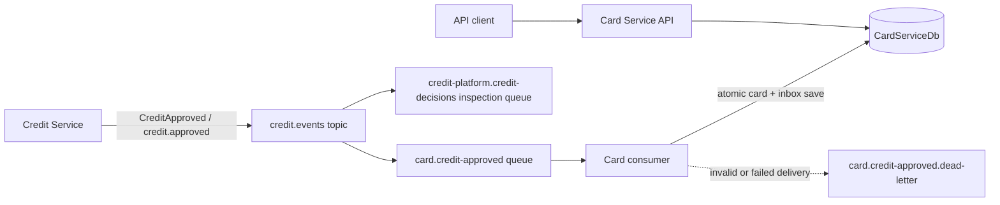

# Card Service architecture

## Responsibilities

Card Service owns the card lifecycle and its `CardServiceDb` database. It does
not access Customer or Credit databases. Customer and credit application ids are
external identifiers, not cross-database foreign keys.

```text
src/
  CardService.API/
  CardService.Application/
  CardService.Domain/
  CardService.Infrastructure/
tests/
  CardService.Tests/
```

- **Domain:** simulated card and allowed status transitions.
- **Application:** event validation and card use cases.
- **Infrastructure:** SQL Server persistence, EF Core migrations, RabbitMQ
  consumer, inbox and dead-letter queue setup.
- **API:** card lookup and status management endpoints.

## Event flow



The Card queue is durable and bound only to `credit.approved`; the independent
inspection queue is left unchanged. RabbitMQ does not replay events published
before a queue and binding existed.

## Idempotency and acknowledgement

The consumer validates the versioned event contract, stores a processed-event
inbox row and a card in one `SaveChanges` operation, then acknowledges the
delivery. The inbox primary key is `eventId`; a unique index on
`creditApplicationId` is a second guard against duplicate cards for the same
approval. Redelivered events therefore do not create a second card.

Invalid deliveries and processing exceptions are logged and rejected without
requeue; the queue's dead-letter configuration routes them to the durable
dead-letter queue for inspection and manual recovery. Consumer acknowledgement
is at least once and occurs only after the database save.

## Demonstration assumptions

- One approved credit application creates one `StandardCredit` card.
- Credit limit equals the approved BRL amount.
- The initial status is `Active`; blocked cards may return to active, but cancelled
  cards are terminal.
- No PAN, CVV, expiry date, or real payment data is generated or stored.
- This is a local portfolio demonstration, not a payment card issuance system.
